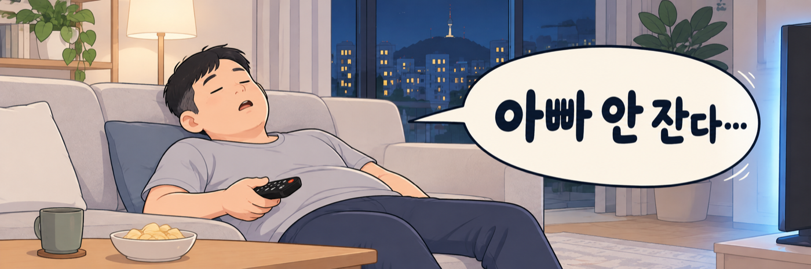
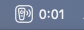
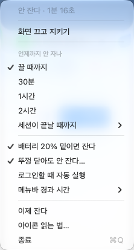
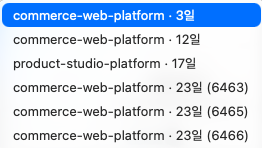

<div align="center">


# 아빠안잔다

**AI 세션이 도는 동안 맥을 안 재우는 메뉴바 앱**<br>
지키고 있는지를 아이콘 모양만 보고 안다



[](https://github.com/badeagle85/dads-watching-this/releases/latest)
[](https://github.com/badeagle85/dads-watching-this/releases)


[](LICENSE)

<table>
<tr>
<td align="center"><br><b>잔다</b><br><sub>안 걸렸다</sub></td>
<td align="center"><br><b>안 잔다</b><br><sub>깨워 두는 중</sub></td>
<td align="center"><br><b>보는 중</b><br><sub>끝나면 풀린다</sub></td>
<td align="center"><br><b>테두리</b><br><sub>뚜껑 설정 켜짐</sub></td>
</tr>
</table>

<sub>테두리는 세 모양 어디에나 붙는다 — 앱 상태와 시스템 설정은 다른 축이다</sub>

<br><br>



<sub>메뉴바에서는 이렇게 보인다</sub>

</div>

---

Claude Code 를 돌려 놓고 자리를 비우면 **세션이 살아 있는지 알 수가 없다.** 돌아와 보면 끊겨 있고, 언제 왜 끊겼는지도 모른다. 그래서 만들었다.

## 필요한 환경

|  | |
|---|---|
| 운영체제 | **macOS 14 (Sonoma) 이상** |
| 칩 | **Apple Silicon** (M1 이상). Intel 맥은 지원하지 않는다 |
| Windows · Linux | **동작하지 않는다** |

맥 전용이다. 맥이 자는 것을 막는 `caffeinate`, 전원 설정을 읽고 쓰는 `pmset`, 메뉴바에 아이콘을 다는 방식까지 전부 macOS 에만 있는 것들이라 다른 운영체제로 옮길 수 없다.

## 설치

```bash
brew tap badeagle85/tap
brew trust badeagle85/tap
brew install --cask dads-watching-this
xattr -dr com.apple.quarantine /Applications/DadsWatchingThis.app
```

> [!IMPORTANT]
> **네 번째 줄을 앱을 열기 전에 실행해야 한다.** 격리 딱지가 붙은 채로 열면 macOS 가 앱을 지우라고 권하고, 확인을 누르면 앱이 사라진다. 그때는 `brew reinstall --cask dads-watching-this` 로 다시 받는다.
>
> **이 네 줄은 처음 한 번만 필요하다.** 그 뒤로는 앱이 스스로 갱신한다.

## 메뉴



메뉴바 아이콘을 누르면 이게 전부다.

| 항목 | 하는 일 |
|---|---|
| **불 끄고 본다** | 자리 비울 때 한 번으로. 유지를 켜고 화면을 끈다 |
| **언제까지 안 자나** | 끝나는 조건. 세션을 고르면 그게 끝날 때 풀린다 |
| **배터리 20% 되면 잔다** | 충전기가 빠진 채 배터리가 줄면 스스로 푼다 |
| **뚜껑 닫아도 안 잔다** | 시스템 설정. 암호는 macOS 가 받는다 |
| **메뉴바 경과 시간** | 아이콘 옆 숫자. 숨기거나 초까지 볼 수 있다 |

전역 단축키 **⌥⌘L** 로 어느 앱에서든 켜고 끈다.

맨 윗줄은 지금 상태다. 메뉴를 열면 설정과 상관없이 **초까지** 보인다.

<br clear="right">

### 세션 지목하기



`이것만 보고 잘게` 에 들어가면 **돌고 있는 Claude Code 세션 목록**이 나온다. 하나를 고르면 그 세션이 끝날 때 유지가 저절로 풀린다.

폴더명과 경과 시간으로 구분하고, 그것까지 같으면 PID 뒷자리를 붙인다. 최근 12시간 안에 띄운 것만, 최대 8개까지 올라온다.

<br clear="right">

## 기능

- [x] 메뉴바에서 상태 확인 — 3가지 모양 × 테두리
- [x] 끝나는 조건 선택 — 계속 본다 / 30분·1시간·2시간만 더 / **이것만 보고 잘게**
- [x] Claude Code 세션 목록에서 지목 (최근 12시간, 폴더명으로 구분)
- [x] 불 끄고 본다 — 화면을 끄면서 유지를 건다
- [x] 뚜껑 닫힘 시스템 설정 읽기·쓰기
- [x] 끊김 이력 — 자리 비운 사이 잠들었으면 시각과 사유
- [x] 알림 3종 — 세션 종료 · 충전기 분리 · 배터리 해제
- [x] 배터리 20% 자동 해제 · 로그인 자동 실행 · 전역 단축키
- [x] **자동 업데이트** — 앱이 스스로 새 버전을 받는다
- [ ] 영어 (지금은 한국어만)
- [ ] 고른 세션이 끝나면 다른 세션으로 이관
- [ ] Codex·Cursor 등 다른 에이전트 연동

## 자주 묻는 것

<details>
<summary><b>비슷한 앱이 이미 있지 않나?</b></summary><br>

`caffeinate` 를 감싸는 앱은 여럿 있지만 전부 켜짐/꺼짐 두 단계다. 이 앱은 **상태를 형태로 보여주고**(색을 못 쓰는 메뉴바에서 윤곽·파동·채움), **세션을 지목**해서 그게 끝날 때 푼다.
</details>

<details>
<summary><b>어떻게 동작하나?</b></summary><br>

macOS 기본 명령 `caffeinate` 를 감싼다.

```
/usr/bin/caffeinate -i -w <앱 PID>
```

`-i` 는 시스템 잠만 막는다 — 자리를 비우는 게 전제라 화면은 평소대로 꺼진다. `-w <앱 PID>` 덕분에 **앱이 죽으면 `caffeinate` 도 같이 죽어** 좀비가 안 남는다.
</details>

<details>
<summary><b>뚜껑을 닫아도 되나?</b></summary><br>

**`caffeinate` 로는 뚜껑 닫힘을 못 막는다.** 실측으로 확인했다 — 충전기를 꽂고 외부 모니터를 빼도 5초 만에 잠든다. 막는 건 시스템 설정 하나뿐이다.

```bash
sudo pmset -a disablesleep 1   # 켜기
sudo pmset -a disablesleep 0   # 되돌리기
```

메뉴의 `뚜껑 닫아도 안 잔다…` 가 이걸 대신 실행한다. 암호는 macOS 가 직접 받고 앱은 보지 못한다. 이 설정은 앱을 꺼도 재부팅해도 남아서, 켜져 있는 동안 아이콘에 테두리가 붙는다. **가방 안에서도 계속 돌아 열이 차니** 다 쓰면 되돌려 두는 게 좋다.
</details>

<details>
<summary><b>설치할 때 왜 명령을 네 줄이나 치나?</b></summary><br>

**Apple 공증을 받지 않았다.** 연 $99 가 드는데, 사용자가 생기기 전에 연회비부터 내는 건 순서가 거꾸로라 보고 **소스 공개**를 택했다. `xattr` 은 "인터넷에서 받았다"는 표시를 떼는 것뿐이다. Homebrew 가 `--no-quarantine` 으로 해 주던 일인데 **7.0 에서 그 옵션이 제거됐다.**
</details>

<details>
<summary><b>업데이트는 어떻게 되나?</b></summary><br>

**앱이 스스로 확인하고 받는다.** 하루 한 번 배경에서 보고, 새 버전이 있으면 창으로 물어본다. 메뉴의 `새 거 있나 보자…` 로 직접 확인할 수도 있다.

Apple 공증을 안 받았는데도 되는 이유는, Apple 서명 대신 **EdDSA 키 서명**으로 무결성을 확인하기 때문이다. 내려받은 앱의 격리 표시는 Sparkle 이 직접 떼므로 설치할 때 쓴 `xattr` 명령을 다시 칠 일이 없다.

`brew upgrade` 를 따로 할 필요도 없다 — cask 에 `auto_updates` 로 표시해 둬서 Homebrew 가 버전 추적을 앱에 맡긴다.
</details>

<details>
<summary><b>알림이 안 온다</b></summary><br>

자가 진단을 돌린다. 권한 상태를 찍고 알림 3종을 보낸 뒤 알림 센터에 실제로 꽂혔는지 다시 읽어서 알려준다.

```bash
DWT_SELFTEST=1 /Applications/DadsWatchingThis.app/Contents/MacOS/DadsWatchingThis
```
</details>

## 직접 빌드하기

**Xcode 가 필요 없다.** Command Line Tools 만 있으면 된다.

```bash
xcode-select --install
git clone https://github.com/badeagle85/dads-watching-this.git
cd dads-watching-this
./build.sh && open build/DadsWatchingThis.app
```

`./test.sh` 로 테스트 40개, `./Tools/build-icon.sh` 로 아이콘을 다시 만든다. 직접 빌드한 앱에는 격리 딱지가 안 붙어 `xattr` 이 필요 없다.

의존성이 **없다.** 아이콘도 SVG 경로를 코드에서 그리고, 세션 종료는 `DispatchSource` 커널 이벤트로 받아 폴링하지 않는다.

## 거들기

버그와 아이디어는 [이슈](https://github.com/badeagle85/dads-watching-this/issues)로. [후원](https://github.com/sponsors/badeagle85)도 받지만 이 앱은 후원과 무관하게 계속 무료다.

## 라이선스

MIT
